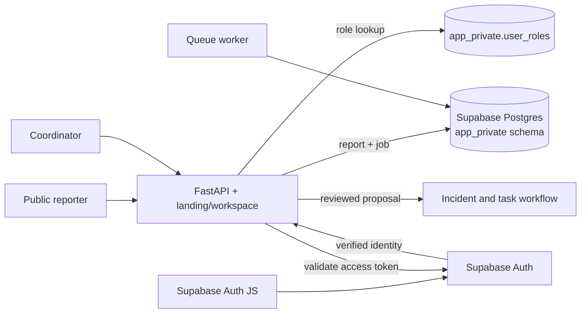

# SANKET AI

SANKET AI is an emergency information coordination prototype. It accepts public text observations, preserves the submitted source, and prepares reviewable proposals for a human coordinator. A coordinator can associate reports with incidents and approve/assign traceable response tasks. It is not an emergency hotline or dispatch service.

## What is implemented

- Public landing page and idempotent text-report intake with a receipt.
- Durable report queue, deterministic extraction, and optional consent-based Google Gemini extraction. Proposals remain unverified until a coordinator reviews them.
- Supabase email/password registration, sign-in, persisted and refreshed sessions, email confirmation, password reset, and sign-out.
- Server validation of access tokens against Supabase Auth. Roles are stored in the private `app_private.user_roles` table, never chosen by the browser.
- Coordinator approval for new accounts, with a coordinator-only account access panel to assign pending, responder, or coordinator roles.
- Supabase Postgres for cloud deployment and SQLite for isolated local tests/demo use.
- Coordinator audit history, report-to-incident review, response task approvals, assignment, and optimistic task version checks.
- React 19, Vite, strict TypeScript, Tailwind CSS, React Router, and TanStack Query for the public and operator interfaces.

The original interface was plain HTML and JavaScript. It has now been migrated to modular React components while preserving the public intake, Supabase auth, review, incident, task, audit, and account-access workflows.

## Supabase project

This workspace is linked to the Supabase project `sanket-ai` in `ap-south-1` (`xvlsfifugklebkdcpjca`). The initial schema migration is committed at [supabase/migrations/20261023054551_initial_schema.sql](supabase/migrations/20261023054551_initial_schema.sql) and has been applied. It creates `app_private` tables with row-level security enabled and no access for Data API roles. The app connects to Postgres from FastAPI; the browser only receives the project URL and publishable key. No records from the pre-existing local `sanket.db` were copied.

Set the Supabase Auth URL configuration before using email links:

1. Open **Authentication → URL Configuration** in the [project dashboard](https://supabase.com/dashboard/project/xvlsfifugklebkdcpjca).
2. Add `http://localhost:8088/**`, `http://127.0.0.1:8088/**`, `http://localhost:5173/**`, and `http://127.0.0.1:5173/**` to **Redirect URLs** for local build and Vite development work.
3. When deployed, set **Site URL** to the deployment's HTTPS origin and add its exact confirmation/reset callback URL to **Redirect URLs**.

Supabase only redirects to an address on that allowlist. The supplied Management API token returned `403` for the Auth configuration update, so these local URLs still need to be added in the Dashboard (or with a token authorized for Auth config writes). See [Supabase Auth redirect URL guidance](https://supabase.com/docs/guides/auth/redirect-urls).

This workspace uses the project's shared session pooler for its IPv4 network. For another host, copy the connection URL from Supabase **Connect**: use the direct connection on IPv6-capable servers or the **Session pooler** on IPv4-only networks. Session mode supports persistent application connections and prepared statements. See [Supabase database connection guidance](https://supabase.com/docs/guides/database/connecting-to-postgres).

## First coordinator and accounts

Before the first account signs in, set `SANKET_BOOTSTRAP_COORDINATOR_EMAIL` to the exact email that will be confirmed in Supabase. On that account's first `/api/v1/auth/me` request after email confirmation, the backend grants the coordinator role. All other new accounts start as `pending` until a coordinator approves them in **Account Access**.

Set the bootstrap email before creating or first signing in to the initial account. Existing profiles keep their assigned role; changing the bootstrap variable does not promote a profile that was already created as pending.

## Local run

Python 3.11+, `uv`, Node.js 24+, and npm are required. For this workspace, project connection values are stored outside the repository in `~/.config/sanket-ai/supabase-project.env`. The helper reads those values without printing them or copying them into the repository. Set the first coordinator's email in the shell before signing up:

```sh
export SANKET_BOOTSTRAP_COORDINATOR_EMAIL='you@example.org'
uv sync --locked --extra dev
uv run python scripts/run_local.py
```

In another terminal, start Vite:

```sh
npm ci
npm run dev
```

Open `http://127.0.0.1:5173` for hot-reloading frontend development. To view the production bundle, run `npm run build` and open `http://localhost:8088`.

Start the background worker in another terminal with the same environment:

```sh
export SANKET_BOOTSTRAP_COORDINATOR_EMAIL='you@example.org'
uv run python scripts/run_local.py python -m app.worker
```

To run the app against an isolated SQLite database instead of Supabase, clear `SUPABASE_DATABASE_URL` and set `SANKET_DB_PATH` to a temporary file. Automated tests already use an isolated temporary database.

## Container run

Copy `.env.example` to `.env`, fill in the three Supabase connection values and the bootstrap email, then run:

```sh
docker compose up --build
```

Compose requires `SUPABASE_URL`, `SUPABASE_PUBLISHABLE_KEY`, and the private `SUPABASE_DATABASE_URL`. Its multi-stage image builds the React frontend with npm before packaging it into FastAPI. Configure the Supabase redirect allowlist for the public deployment URL. The app and worker both use the hosted database; Compose does not mount the existing local SQLite file.

## Configuration

| Variable | Purpose |
|---|---|
| `SUPABASE_URL` | Supabase project Auth/API origin |
| `SUPABASE_PUBLISHABLE_KEY` | Browser-safe key used by Supabase Auth JS and server token validation |
| `SUPABASE_DATABASE_URL` | Private Postgres connection string, used only by FastAPI and the worker |
| `SANKET_BOOTSTRAP_COORDINATOR_EMAIL` | Confirmed email to receive the initial coordinator role |
| `SANKET_DB_PATH` | Local SQLite path when `SUPABASE_DATABASE_URL` is unset |
| `GEMINI_API_KEY` | Optional Google Gen AI credential; empty disables provider calls |
| `GEMINI_MODEL` | Gemini model id, default `gemini-3.8-flash` |
| `ALLOWED_ORIGINS` | Allowed browser origins for API requests |
| `SANKET_PORT` | Local/Compose host port, default `8088` |
| `SANKET_DEMO_TOKENS` | Optional local-only compatibility switch for tests/demos; keep disabled in deployment |

Never put the Postgres URL or password in browser code, Git, or a public static environment. The publishable key is intended for browser use; no legacy `service_role` or secret key is used by this app.

## Architecture



The app validates bearer access tokens through Supabase Auth's `/auth/v1/user` endpoint and resolves roles from Postgres. Postgres tables live in a private schema; the browser does not query tables directly. All user role changes are checked by coordinator-protected API routes and written to the audit table.

## Routes and operations

- `GET /healthz` reports process liveness.
- `GET /readyz` checks the configured SQLite or Postgres database.
- `GET /api/v1/config` returns browser-safe Supabase Auth settings and whether Gemini is configured.
- `GET /api/v1/auth/me` validates a session and returns the server-assigned role.
- `GET /api/v1/users` and `PATCH /api/v1/users/{id}/role` are coordinator-only account administration routes.
- `python -m app.worker` runs the queue worker; `python -m app.worker --once` processes at most one report.

## Verification and known limits

The Supabase migration is applied; all nine application tables were checked for RLS, and the Supabase security advisor reported no warnings. Unit/API tests exercise the SQLite implementation and mocked Auth identities. Docker is not installed in this environment, so the container build was not run. The hosted signup, email delivery, password reset email, and login were not exercised with a real user account.

Supabase's default email delivery is suitable for setup/testing but has rate limits; configure a trusted custom SMTP provider before inviting a larger user group. Production also needs its HTTPS site URL/redirect allowlist, the first coordinator email, secret deployment, backups, retention policy, monitoring, and a real deployment host. Do not use this prototype to receive real emergency-sensitive reports until those operational controls are reviewed.

The system does not dispatch resources. Gemini and deterministic extraction produce proposals only. Geolocation, maps, evidence uploads, organization tenancy, real-time updates, rate limiting, and a calibrated triage model are out of scope in this workspace.
